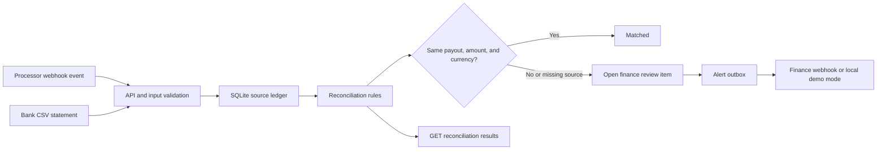
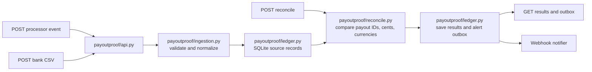

# PayoutProof

PayoutProof helps a marketplace finance team find payment settlements that do not match the bank statement. It correlates processor payout events with bank deposit rows, explains the difference in cents, and leaves an evidence-linked review item for a person to resolve.

## The architecture in one picture



The source records stay in the ledger; a reconciliation run creates a separate view over them. Amounts use integer cents. The service never moves money or edits processor and bank records.

## Follow the code



## Setup and run

Requires Python 3.9+ and Make. It uses only the Python standard library.

```bash
make setup
make run
```

The service listens on `http://127.0.0.1:8090`. In another terminal, load sample processor and bank records, then reconcile them:

```bash
curl -X POST http://127.0.0.1:8090/api/demo
curl http://127.0.0.1:8090/api/reconciliations
curl http://127.0.0.1:8090/api/outbox
curl http://127.0.0.1:8090/health
```

The demo includes a matched payout, a payout with an amount mismatch, a processor payout not found in the bank file, and a bank-only deposit. Notifications are written to the local outbox by default.

### Send a processor settlement event

```bash
curl -X POST http://127.0.0.1:8090/api/processor/events \
  -H 'Content-Type: application/json' \
  -d '{"event_id":"evt-new-1","type":"payout.settled","data":{"payout_id":"po-new-1","amount_cents":9850,"currency":"USD","expected_date":"2026-10-23"}}'
```

### Import a bank statement

```bash
curl -X POST http://127.0.0.1:8090/api/bank/import \
  -H 'Content-Type: application/json' \
  -d '{"csv":"payout_ref,bank_ref,amount,currency,booked_at\npo-new-1,bank-new-1,98.50,USD,2026-10-23"}'
curl -X POST http://127.0.0.1:8090/api/reconcile
```

`amount` in the CSV is decimal currency; processor webhook `amount_cents` is already integer cents. The parser rejects ambiguous or malformed money values.

## Checks

```bash
make test
make check
```

Tests cover matching and mismatch rules, bank-only and processor-only cases, repeated processor events, repeated statement imports, malformed data, unsafe numeric inputs, webhook success, and downstream failure preservation.

## Deployment

Build a local container and persist its SQLite ledger with a volume:

```bash
docker build -t payoutproof .
docker run --rm -p 8090:8090 -v payoutproof-data:/data \
  -e DATABASE_PATH=/data/payoutproof.sqlite payoutproof
```

Set `FINANCE_ALERT_WEBHOOK_URL` to connect a customer-owned ticket or chat receiver. Without it, alerts remain visible in `/api/outbox`. Structured JSON logs include request outcomes. `/health` checks SQLite availability. `.env.example` lists supported variable names without values.

## Limitations

- The processor webhook shape is an educational adapter; production use needs signature verification, replay windows, account scoping, and processor-specific API pagination.
- Bank statements are supplied as CSV; production connections require a bank-approved feed and customer-specific formats.
- The model assumes one bank credit per payout reference. Split settlements, reserves, chargebacks, FX conversions, and timing windows need customer discovery and explicit matching rules.
- An unmatched row is a review item, not proof of loss or fraud. A finance operator must verify source evidence before taking action.
- The SQLite and webhook setup is a single-process demo, not a highly available accounting system. Do not use it to move funds or make ledger entries.

## Project files

- [`docs/architecture.svg`](docs/architecture.svg): annotated system picture.
- [`docs/demo_flow.md`](docs/demo_flow.md): step-by-step operator walkthrough.
- [`docs/job_market_research.md`](docs/job_market_research.md): reviewed job postings and design implications.
- `payoutproof/`: HTTP entry point, ingestion adapters, ledger, and reconciliation rules.
- `tests/`: deterministic unit and local HTTP integration tests.
- `fixtures/`: synthetic processor events and bank statement.

**Author: Asresh**
